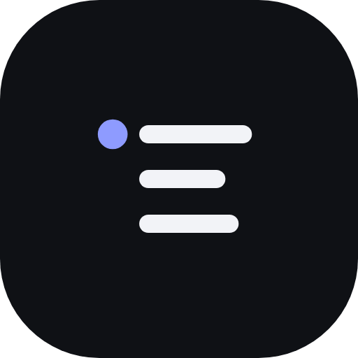
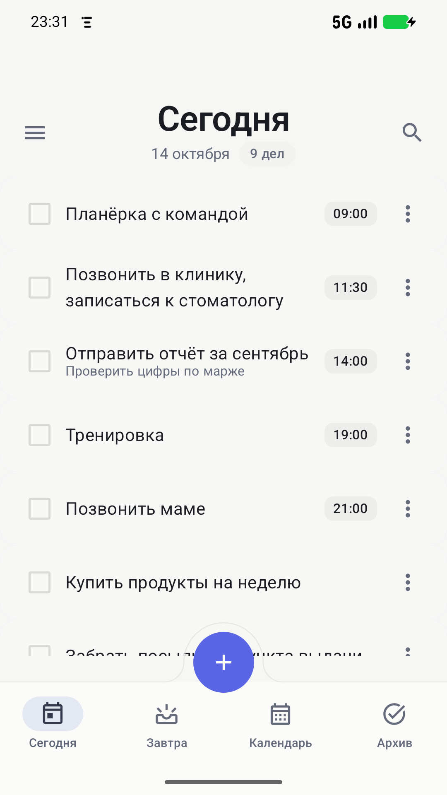
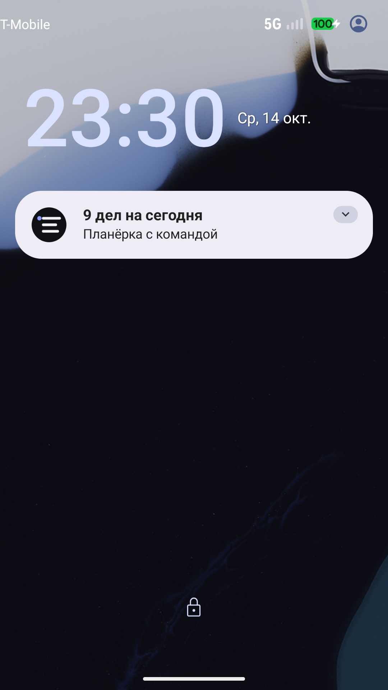
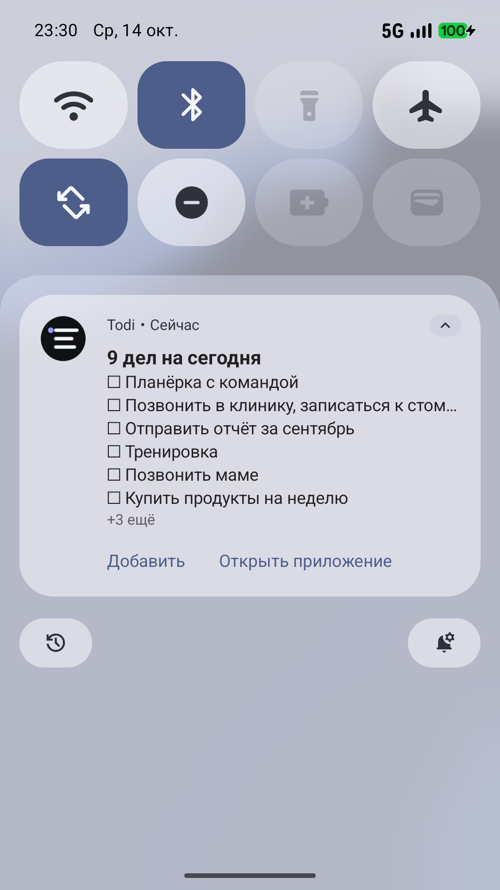
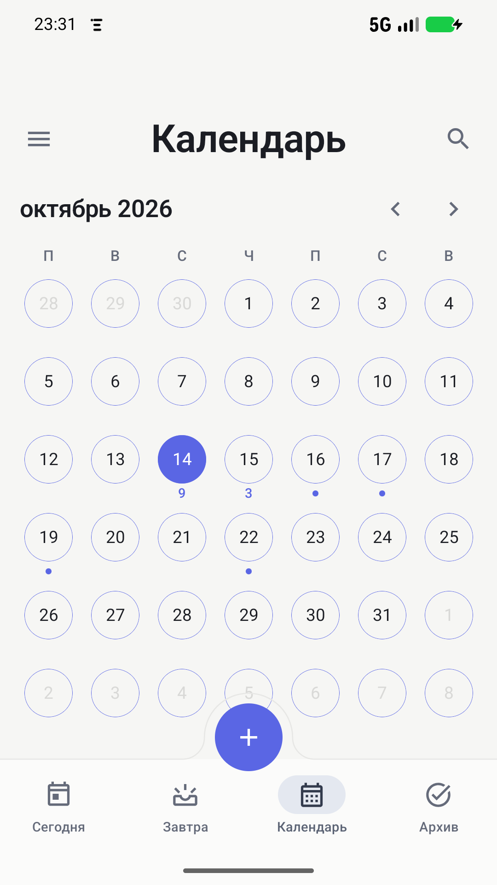
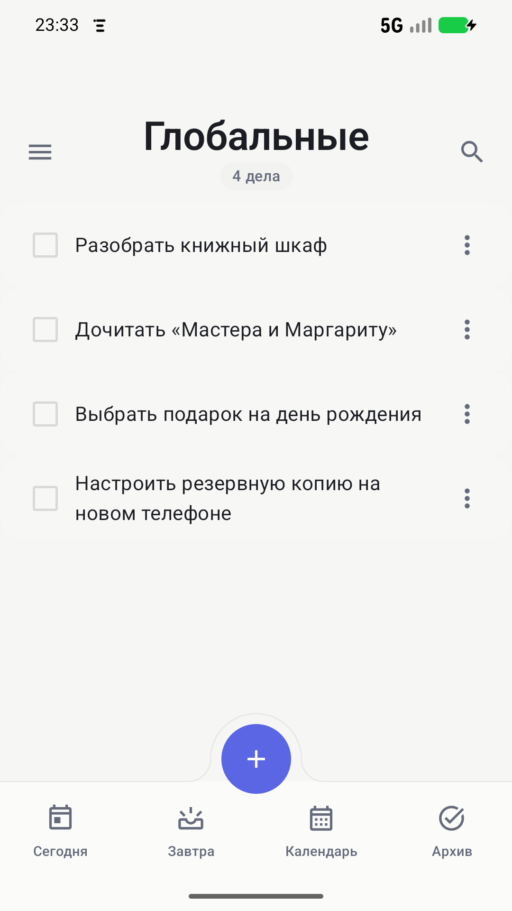
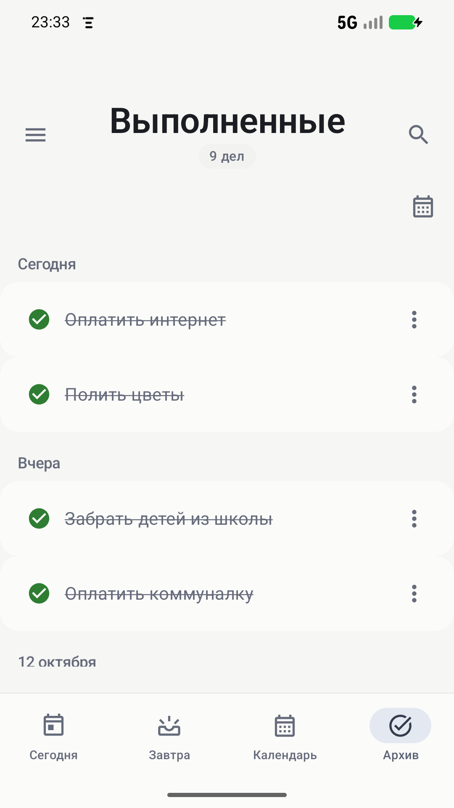
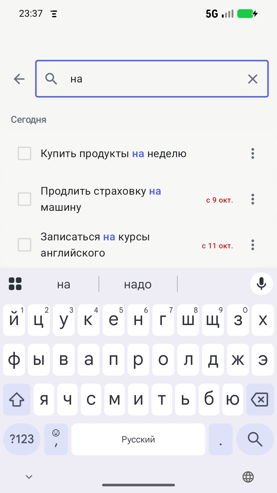
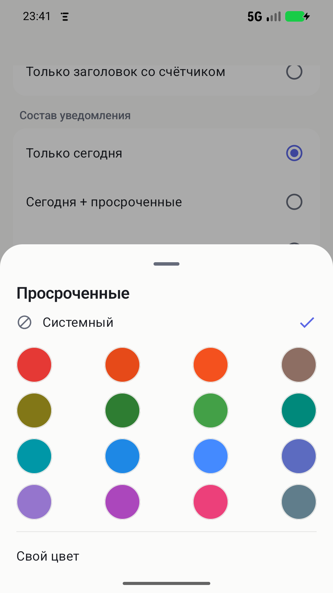

<p align="center">
  
</p>

<h1 align="center">Todi</h1>

<p align="center">
  A date-based to-do list that stays visible on the lock screen.
</p>

<p align="center">
  <a href="https://github.com/veterAN911/todi/actions/workflows/ci.yml"></a>
  <a href="LICENSE"></a>
  
  
  
  
</p>

<p align="center">
  <a href="README.md">Русский</a>
</p>

<p align="center">
  <a href="https://groups.google.com/g/-todi">Testing group</a> ·
  <a href="https://play.google.com/store/apps/details?id=com.todi.appp">Google Play</a> ·
  <a href="https://github.com/veterAN911/todi/releases/latest">APK</a>
</p>

## About

Todi is a local-first Android task manager. Tasks live on their dates, and the
main feature is a persistent system notification listing today's active tasks.
It stays in the notification shade and on the lock screen, updates itself, and
lets you see the plan without opening the app.

No account, no ads, no analytics. Task content never leaves the phone, except
for an optional backup to a server chosen by the person who builds the app.

## Download

**Google Play, closed testing.** The app is in closed testing, so you need to
join the tester list first:

1. Join the group: [groups.google.com/g/-todi](https://groups.google.com/g/-todi)
   (anyone can join) or use `-todi@googlegroups.com`.
2. Once you have joined, open the app page in Google Play:
   [play.google.com/store/apps/details?id=com.todi.appp](https://play.google.com/store/apps/details?id=com.todi.appp).

The Play link works only for group members. Without joining, the store reports
that the app is unavailable.

**APK directly.** A signed APK is attached to
[Releases](https://github.com/veterAN911/todi/releases/latest). Download
`todi-1.0.1.apk` and install it on your phone (Android 8.0 or newer). Installing
from a file requires allowing installs from that source.

## Features

- **Today, Tomorrow and Calendar** — a day list, a six-week month grid and
  per-day task dots.
- **Date-less tasks** — a separate list for items that are not tied to a day and
  should never be carried over.
- **Automatic rollover** — unfinished tasks from previous days move to today in
  the morning and are marked "since Aug 29"; the original date is preserved.
- **Lock-screen notification** — today's list, per-section colors and a
  configurable scope: today only, today plus overdue, or plus date-less tasks.
  A counter-only mode never exposes task titles, even in the expanded card.
- **Section colors** — a 16-color palette checked for contrast on both light and
  dark notification backgrounds; custom colors are also supported.
- **Date-less reminder** — a separate notification with a configurable interval
  and quiet hours.
- **Voice input** — hold the "+" button and pull up; recognition runs offline on
  the device through Vosk, with no audio sent over the network. The dictated
  phrase is split into tasks, dates and times.
- **Search** across titles and notes, including completed and date-less tasks,
  with match highlighting.
- **Archive** of completed tasks grouped by completion date, as a list or a
  month grid, with a restore action that asks which day to return the task to.
- **Phone calendar** — optional export of dated tasks to the device's primary
  calendar.
- **Backup** — optional snapshot upload to a self-hosted server, at most once
  every 12 hours or on demand; the server keeps the 10 latest copies.
- **Two languages** — Russian and English, light and dark themes.
- **Configurable bottom bar** — phones and tablets show only the sections chosen
  in settings; every section remains reachable from the drawer.

## Screenshots

<table>
  <tr>
    <td></td>
    <td></td>
    <td></td>
    <td></td>
  </tr>
  <tr>
    <td align="center">Today</td>
    <td align="center">Lock screen</td>
    <td align="center">Notification shade</td>
    <td align="center">Calendar</td>
  </tr>
  <tr>
    <td></td>
    <td></td>
    <td></td>
    <td></td>
  </tr>
  <tr>
    <td align="center">Date-less tasks</td>
    <td align="center">Archive</td>
    <td align="center">Search</td>
    <td align="center">Section colors</td>
  </tr>
</table>

## Stack

| Layer | Technologies |
|---|---|
| Language and UI | Kotlin 2.2, Jetpack Compose, Material 3 |
| Architecture | MVVM, Clean Architecture, Coroutines and Flow |
| Storage | Room, DataStore Preferences |
| DI | Hilt |
| Background work | WorkManager |
| Networking | OkHttp |
| Voice | Vosk Android, offline Russian model |
| Calendar | CalendarContract |
| Build | AGP 9.2, Gradle 9.4.1, KSP, R8 |

Minimum Android version is 8.0 (API 26); target is Android 16 (API 36).

## Building

You need JDK 21 and an Android SDK with platform `android-36.1`, build-tools
36.x and platform-tools. Gradle and Kotlin do not need to be installed: the
wrapper downloads Gradle, and Kotlin is built into AGP 9.

```bash
git clone https://github.com/<owner>/todi.git
cd todi
./gradlew :app:assembleDebug
```

If the SDK is not detected automatically, create `local.properties`:

```properties
sdk.dir=/path/to/Android/sdk
```

Common commands:

```bash
make doctor
make test
make lint
make ktlint
make verify
make build-debug
make bundle
make size
make ui-test
```

Run `make help` for the full list.

## Configuration

The backup server address is compiled into the app through `gradle.properties`:

```properties
todi.backupServerUrl=https://example.com
```

An empty value means there is no default server: the app reports that backup is
unavailable instead of calling an unknown host. The server protocol is described
in [docs/BACKUP.md](docs/BACKUP.md); the server itself is not part of this
repository.

The release signing key is read from `keystore.properties` in the repository
root. The properties file and the key are excluded from version control; use
`make init-keystore` to create them.

## Project layout

```
app/src/main/java/com/todi/app/
├── backup/          backup transport and snapshot handling
├── calendar/        phone calendar synchronization
├── data/            Room, DataStore, repositories
├── di/              Hilt modules
├── domain/          models, use cases, pure utilities and parsers
├── notification/    notifications, channels, workers and receivers
└── presentation/    Compose screens, ViewModels, navigation, voice input
```

See [docs/ARCHITECTURE.md](docs/ARCHITECTURE.md) for layers, data flow and
design decisions. The technical documentation is written in Russian.

## Documentation

- [docs/ARCHITECTURE.md](docs/ARCHITECTURE.md)
- [docs/DEVELOPMENT.md](docs/DEVELOPMENT.md)
- [docs/BACKUP.md](docs/BACKUP.md)
- [docs/RELEASE.md](docs/RELEASE.md)
- [docs/PRIVACY.md](docs/PRIVACY.md)
- [CHANGELOG.md](CHANGELOG.md)
- [CONTRIBUTING.md](CONTRIBUTING.md)

## Application ID

The source namespace is `com.todi.app`, while `applicationId` is
`com.todi.appp`. The latter is historical: it is already published, and an
`applicationId` cannot change after the first release. Renaming the namespace is
not required and does not affect the installed application's identity.

## License

[MIT](LICENSE). Third-party libraries keep their own licenses. The Vosk speech
model is downloaded separately and is not included in this repository.
